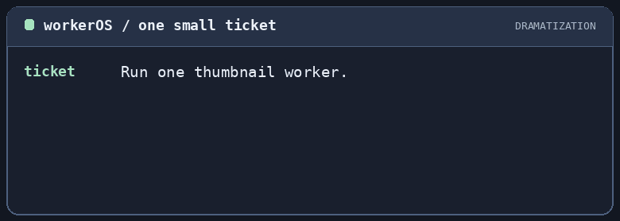

# 

**Run a job. Know how it ended.**

Run a local command on Linux or WSL2. See whether it finished, timed out,
or still needs checking before you try again.

**[Install and run](#install-and-run)**

[Read the terminal comic transcript](docs/media/README.md#everything-is-green)

<details open>
<summary>Show or hide the terminal comic</summary>



</details>

<a name="run-one-worker"></a>
<a name="run-a-job"></a>

## Install and run

Open a **Linux or Ubuntu WSL2 terminal** with Python 3.11+ and `venv`.
In a fresh project folder, paste these commands to try the published
**v0.7.0** release. No checkout or administrator access needed.

```sh
release='https://github.com/'\
'thisistuhinsen/workerOS/releases'\
'/download/v0.7.0'
wheel='workeros-0.7.0-py3-none-any.whl'
sha='1a418f20bffcfbed304855edb6663ce3'\
'5c75c818b3f0af1ff51b6dc445e92c3b'
python3 -m venv .venv-0.7.0 &&
.venv-0.7.0/bin/python -m pip \
  install --no-index --no-deps \
  "$release/$wheel#sha256=$sha" &&
.venv-0.7.0/bin/workeros-demo -- \
  /usr/bin/printf 'hello\n'
```

```text
hello
job: exited 0
```

If Python or `venv` is missing, install your distribution's Python 3.11+
and venv package. If you're in PowerShell or Command Prompt, open Ubuntu
in WSL2 first. If the install reports a checksum mismatch, stop; don't
drop the digest to force it. [Other install help](docs/support.md#windows-and-macos).
If a job times out or its effect is unclear, read
[the recovery steps](docs/support.md#troubleshooting) before retrying. For
package upgrades, use the [versioned install reference](docs/install.md).

Use ordinary subprocess when its result is enough. Keep scheduling and retries
in your queue; WorkerOS supervises the local command and reports what it saw.

## What would you like to do next?

| | Start here |
| --- | --- |
| **Terminal** | [Run a job](docs/start/terminal.md) · [v0.8.0 structured result](docs/start/terminal.md#run-a-job-from-terminal-v080) |
| **Config** | [Published v0.7.0 JSON](docs/start/config.md#run-from-json) · [v0.8.0 JSON](docs/start/config.md#run-from-json-v080) · [v0.8.0 YAML](docs/start/config.md#run-from-yaml) |
| **Code** | [Python hello](docs/start/code.md#run-hello-from-python) · [v0.8.0 Python hello](docs/start/code.md#run-hello-from-python-v080) · [v0.8.0 named-file handoff](docs/start/code.md#give-a-worker-an-open-file-v080) |

<a name="packages"></a>
<a name="language-packages"></a>
<a name="write-a-worker"></a>

**Install for your language:** use the [published v0.7.0 package-manager
steps](docs/start/install.md) for the stable release. The [v0.8.0
package-manager guide](docs/install-0.8.0.md) is version-pinned; use a verified
offline bundle or its GitHub release assets after publication. Both Python
installers create the same `.venv-0.7.0`; choose one in a fresh folder.

**Have an approved managed workflow?** With a verified v0.8.0 candidate,
[submit and check it](docs/start/terminal.md#run-and-check-an-approved-worker)
from your ordinary account. The administrator uses the separate
[guarded setup walkthrough](docs/guarded-walkthrough.md).

<a name="try-a-timeout"></a>
<a name="configure-a-workflow-once"></a>
<a name="run-an-inherited-fd-example"></a>
<a name="give-a-worker-the-file-you-opened"></a>

## Guides and reference

The [first-use guides above](#what-would-you-like-to-do-next) default to
published v0.7.0. The version-pinned v0.8.0 links form a parallel candidate
path; use them with a verified offline bundle or after the matching release.
For production integrations: [Python API](docs/api.md) · [configuration
reference](docs/configuration.md) · [worker API](docs/workers.md) ·
[authorized host setup](docs/host-preflight.md) ·
[agent skill](skills/workeros/SKILL.md).

For v0.7.0 upgrades or offline installs, see the [stable installation
reference](docs/install.md). The [v0.8.0 candidate guide](docs/install-0.8.0.md)
is separate; use it with a verified offline bundle or after the matching
release is published.

## Verify and contribute

[Latest published release](https://github.com/thisistuhinsen/workerOS/releases/latest) ·
[Platform support and troubleshooting](docs/support.md) ·
[Contributing](CONTRIBUTING.md) · [Report a security issue](SECURITY.md) ·
[MIT license](LICENSE)

[](https://github.com/thisistuhinsen/workerOS/actions/workflows/linux.yml?query=branch%3Amain+event%3Apush)
[](https://github.com/thisistuhinsen/workerOS/actions/workflows/wsl2.yml?query=branch%3Amain+event%3Apush)
