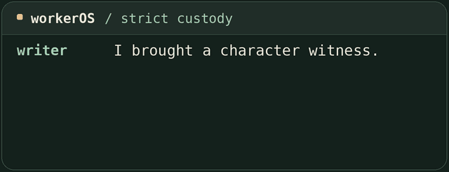

# workerOS

Starting a subprocess is easy. Keeping track of a renderer, a sync job,
and an auditor that all start and finish differently is where your app
starts growing its own process manager. When one job times out, you need
to know what actually happened before you retry it.

workerOS gives Python apps a small, local worker layer on Linux. Name the
workers and their roles, run trusted callables or executables, and supervise
direct children. Pass an open file only when a job needs one. Start with one
worker, or run several without wiring up a queue first.


[Read the cartoon as text](docs/media/README.md#everything-is-green).

- **Run a calculation or invoke a tool.** Give the worker a name and join it
  for an exit status. Use the direct-child supervisor when you need a
  deadline, cancellation, or bounded cleanup.
- **Register a process you already run.** Record its name, role, and PID. Registration doesn't check
  liveness or take over the process.
- **Hand a worker the file you actually opened.** Inherit its descriptor at
  launch or send a read-only descriptor over a connected Unix socket. Use
  the optional release and custody checks when the handoff needs stricter
  evidence.

## Install

Install `worker-handoff` on Linux with Python 3.11+. Import it as
`worker_handoff`. The Python package is the controller: it can launch and
supervise workers with or without file inputs. The other language packages
are readers for the inherited file-descriptor interface. An executable can
run without a reader package if it doesn't need that interface.

These links go straight to the v0.4.0 GitHub release assets.

- [Python wheel](https://github.com/thisistuhinsen/workerOS/releases/download/v0.4.0/worker_handoff-0.4.0-py3-none-any.whl)
- [Python source distribution](https://github.com/thisistuhinsen/workerOS/releases/download/v0.4.0/worker_handoff-0.4.0.tar.gz)
- [npm tarball](https://github.com/thisistuhinsen/workerOS/releases/download/v0.4.0/worker-handoff-0.4.0.tgz)
- [C and C++ Conan recipe](https://github.com/thisistuhinsen/workerOS/releases/download/v0.4.0/worker-handoff-conan-0.4.0.tar.gz)
- [Java Maven JAR](https://github.com/thisistuhinsen/workerOS/releases/download/v0.4.0/worker-handoff-0.4.0.jar) and [POM](https://github.com/thisistuhinsen/workerOS/releases/download/v0.4.0/worker-handoff-0.4.0.pom)
- [SHA256SUMS](https://github.com/thisistuhinsen/workerOS/releases/download/v0.4.0/SHA256SUMS)

With the checksum file and its listed assets in the same directory, run
`sha256sum -c SHA256SUMS`.

Set the base URL once for the install commands below.

```sh
release=https://github.com/thisistuhinsen/workerOS/releases/download/v0.4.0
wheel="$release/worker_handoff-0.4.0-py3-none-any.whl"
```

**pip** in a fresh environment

```sh
python3 -m venv .venv
. .venv/bin/activate
python -m pip install "$wheel"
```

**uv pip** in a fresh environment

```sh
uv venv
uv pip install --python .venv/bin/python "$wheel"
. .venv/bin/activate
```

**uv add** in an existing uv project

```sh
uv add "worker-handoff @ $wheel"
```

Use `uv run` to run the example or application in that project environment.

**npm** in your Node.js project

If you manage Node.js with [nvm](https://github.com/nvm-sh/nvm), select a
supported Node version first, for example `nvm install 22` and `nvm use 22`.

```sh
npm install "$release/worker-handoff-0.4.0.tgz"
```

On npm 12, opt into that direct URL with `--allow-remote=all` or download the
tarball and install it from disk.

## Run three workers without a file

Run this with the package installed on Linux or WSL2 with pidfd support.
Here's the [three-worker example](examples/run_local_workers.py). The three
tiny commands stand in for tools your app already uses. It starts all three
before waiting for any of them, keeps every started handle, and reports
each result and cleanup separately. No file bindings, shell, or queue.

From a workerOS checkout with the released Python package installed:

```sh
python examples/run_local_workers.py
```

Expected: each worker reports exit `0` and `cleanup reaped`. Their own output
can arrive in any order. The supervisor manages direct children it launches
or is explicitly given control of. To run an importable Python callable
instead, use `WorkerRoster.start`. Roles are application labels, not OS
permissions. workerOS doesn't provide a sandbox or a distributed queue.
A roster or supervisor keeps used names for its lifetime; use a fresh
instance for a new finite workload if names need to be reused. See
[Support and recovery](docs/support.md) for ownership and timeout behavior.

## Packages

The Python and npm commands above install directly from GitHub. Go and Cargo
read the `v0.4.0` source tag. The Maven and Conan examples install GitHub
assets into the local package-manager cache. Each directory has a clean
consumer example and a Linux FD smoke test.

| Worker | Package manager | Package or source |
| --- | --- | --- |
| Python | pip or uv | `worker-handoff` from the wheel above |
| Node.js | npm | `worker-handoff` from the tarball above. Linux x64 or ARM64 with procfs and Node.js 22+ |
| Go | Go modules | `GOPROXY=direct go get github.com/thisistuhinsen/workerOS/go/workerhandoff@v0.4.0` · [Go reader and checksum fallback](go/README.md) |
| Rust | Cargo | `worker-handoff = { git = "https://github.com/thisistuhinsen/workerOS", tag = "v0.4.0" }` · [Rust reader](rust/) |
| C | Conan 2 | `worker-handoff/0.4.0` · [C consumer](native/tests/c/) |
| C++ | Conan 2 | `worker-handoff/0.4.0` · [C++ consumer](native/tests/cpp/) |
| Java | Maven | `io.github.thisistuhinsen:worker-handoff:0.4.0` · [Install and run a Java consumer](java/) |

These are GitHub-hosted packages. Maven users install the released JAR with
its matching POM before resolving the normal Maven coordinates. Conan users
create the released recipe in a local cache before installing that package
into their project. [Conan install instructions](native/README.md)

## Run an inherited FD example

Your worker needs the file you opened, even if someone has already renamed it
to `report-final-FINAL.txt`. The filename can change; the open descriptor
still refers to the same file. The worker can get on with its day.


[Read the report handoff as text](docs/media/README.md#report-handoff).

With the wheel's Python environment active, run its bundled launcher. It
creates one disposable input file, gives each worker an inherited read-only
descriptor, and checks the byte read, child exit status and parent's file
offset.

```sh
launcher="$(python -c 'import sys; print(sys.prefix)')/share/worker-handoff/examples/run_inherited_fd.py"
python -I "$launcher" --language python
```

For the npm-installed reader, follow the
[runnable Node.js walkthrough](node/README.md#read-one-inherited-file).
It starts the example from `node_modules` through Python and checks that the
parent's file offset stays put.

Remove `--language python` to try C, C++, Go, Java, Node.js, Python and Rust
with the toolchains on your machine. Java needs a JDK 22+ on 64-bit Linux.
Default discovery reports unavailable toolchains. An explicitly selected
example exits unsuccessfully if it cannot run.

Read the worker sources directly. [C](examples/read_worker.c) ·
[C++](examples/read_worker.cpp) · [Go](examples/read_worker.go) ·
[Java](examples/ReadWorker.java) · [Node.js](examples/read_worker.cjs) ·
[Python](examples/read_worker.py) · [Rust](examples/read_worker.rs) ·
[Launcher](examples/run_inherited_fd.py)

From a source checkout, you can also run the
[C report pipeline](examples/run_local_report.py) with one writer, two readers
and two observers. Use the environment where you installed the Python package.

```sh
(
    set -eu
    work="$(mktemp -d)"
    trap 'rm -rf -- "$work"' EXIT
    cc -std=c11 -Wall -Wextra -Werror examples/report_worker.c -o "$work/report_worker"
    python examples/run_local_report.py "$work/report_worker"
)
```

## Use the optional Node.js reader

In a Node worker launched with the inherited `INPUT` binding, import
`openInherited` from the npm package. This example reads up to 64 bytes at
offset zero, then closes the owned descriptor.

```js
import { openInherited } from "worker-handoff";

const input = openInherited("INPUT", { ownership: "owned" });
try {
  const buffer = Buffer.alloc(64);
  const count = input.readAt(buffer, 0);
  process.stdout.write(buffer.toString("utf8", 0, count));
} finally {
  input.close();
}
```

CommonJS can use `require("worker-handoff")`. The default `borrowed` ownership
leaves the descriptor open when the wrapper closes. The helper checks the
named ABI binding against the live file's device, inode and access mode. It
reads from `read` and `read-write` bindings. Keep the descriptor slot stable
while the handle is open. Validation failure leaves the slot with its caller.
Start the [packaged reader](node/examples/read-input.cjs)
through a launcher that supplies the actual FD. Launch, Unix-socket handoff,
supervision and custody use the Python APIs below.

## Python APIs

- **Manage local workers.** Use `WorkerRoster` to register an existing worker,
  start a Python handler or launch a trusted executable with argv and explicit
  descriptor bindings. Joining a worker the roster owns reports its exit
  status or a timeout. A join timeout leaves the worker alone. The roster
  keeps used names for its lifetime. Application roles are labels, and even
  an `observe` worker can read contents if it receives a readable FD.
- **Work on an open file.** `Writer` writes through a caller-owned writable
  descriptor. `Original` adopts and reads an existing read-only descriptor
  with positional reads. `observe(fd)` samples identity, access mode, owner
  and size without reading file contents.
- **Deliver over a Unix socket.** `send_original` and `receive_original` use
  one connected Unix stream with a pinned peer PID and UID. They transfer one
  read-only descriptor via `SCM_RIGHTS`, with the caller-pinned token and EOF
  required by the frame. Each side consumes its socket.
- **Inherit at launch.** The ABI uses `WORKER_HANDOFF_ABI=1` and a binding such
  as `WORKER_HANDOFF_FD_INPUT`. The number names a descriptor in the child.
  Authorization comes from the application that granted it.
  It shares the underlying open file description with the parent. Positional
  reads preserve the shared offset. File contents can still change if a
  writer holds access. Keep the parent's source descriptors stable during launch.

[Python source and public exports](src/worker_handoff/__init__.py).
The v0.2 Python APIs, Unix-stream framing and inherited FD ABI remain compatible.

### Authorize a managed release

Use `release_executable` with a frozen `ReleasePlan`, a caller-owned read-only
FD and a policy callback that returns `True` for the exact plan. The plan
names the file identity, worker, absolute executable argv and monotonic
deadline. The child gets a read-only `INPUT` binding and the ABI environment.

- **Optional write.** Add a `PositionalWrite` and a writable descriptor for the
  same file. The managed write rejects append mode. A short or uncertain write
  stops dispatch and needs caller reconciliation. The file may already have
  changed, even if the child never starts.
- **Optional writer exclusion.** Set `exclusive_writer=True` to take an
  advisory `flock` on the actual file through dispatch. This coordinates
  writers that use the same lock protocol.
- **Optional supervision.** Use `DirectChildSupervisor` for a direct child's
  exit, timeout or cancellation. Set a separate `cleanup_due_ns` to request
  bounded termination and reaping after timeout or cancellation. Linux
  pidfds pin the child. An observed external worker stays with its owner.
  `adopt` takes explicit wait and signal authority over a waitable direct
  `Popen` child. Descendants remain the application's responsibility.
- **Optional strict custody.** Set `strict_custody=True` to require an
  authenticated pre-grant attestation from a deployment-trusted independent
  observer. The observer checks the exact `plan.custody_scope`, provenance,
  prior grants and retirements, and applicable writer exclusion through the
  grant window. Missing or unqualified evidence stops the write and dispatch
  before the worker receives the descriptor.



[Read the custody exchange as text](docs/media/README.md#strict-custody).
The deployment supplies the observer and pins its Linux PID and UID. See the
[custody protocol](src/worker_handoff/custody.py).

`ReleaseResult` reports delivery, write effect, custody evidence, lifecycle
and local descriptor cleanup separately. An authenticated receipt covers
pre-grant custody. Dispatch records child creation, and `lifecycle.cleanup`
records the outcome of requested process cleanup. Reconcile a completed or
uncertain write before deciding what to do about a failed or uncertain dispatch.

## Verify and contribute

- [Linux wheel check](scripts/check-linux.sh) builds the wheel, installs it
  offline into a fresh venv, and runs the Python tests and bundled examples.
  Run `bash scripts/check-linux.sh` from the checkout.
- [Node package](node/package.json) has its own tests. From the checkout, run
  `npm --prefix node test` with Node.js 22+ and Python 3.11+ on Linux.
- [Strict custody fixture](scripts/check-strict-custody-linux.py) exercises a
  read-only grant over a sealed file and refusal paths using separate Linux
  accounts in a disposable VM. See the prerequisites in the
  [support and verification notes](docs/support.md).
- [Linux CI](.github/workflows/linux.yml) records the tested platforms and
  separates runner-kernel tests from container userspace checks. See the
  [support boundaries](docs/support.md) for native Windows and WSL2.
- [Release process](docs/releasing.md) describes the candidate checks,
  checksums and protected GitHub release.
- [Contributing](CONTRIBUTING.md) and [security reporting](SECURITY.md) cover
  local development and where to report issues.

[MIT License](LICENSE).
