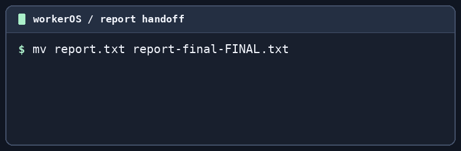
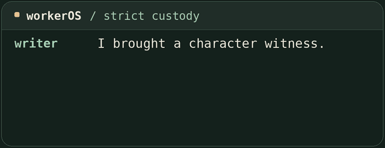

# Worker APIs and examples

Start with [one worker](../README.md#run-one-worker) or [choose a package](install.md)
from the WorkerOS 0.7.0 offline bundle. The Python API starts, supervises,
and passes files to workers on Linux. Use an ordinary executable as a worker,
and add the language reader when it needs an open file from your app.

For native method signatures, see the [API reference](api.md). To choose
workflows, resources and evidence routes through one JSON policy, see the
[installed controller](configuration.md). Its ordinary local launch uses
resources the operator enrolls before accepting the request.

## Choose an example

| Job | Example |
| --- | --- |
| Run one worker | [Installed fileless smoke](../README.md#run-one-worker) |
| Read a file already opened by the application | [Bundled inherited FD launcher](../README.md#run-an-inherited-fd-example) |
| Use an installed language package | [Package entry points and examples](install.md) |

[Terminal cartoon transcripts](media/README.md) include the complete dialogue.

### Source checkout examples

These run from a public source checkout. The fileless multi-worker script and
the report pipeline are source examples.

- [Start three workers before waiting](../examples/run_local_workers.py).
  The script retains and reaps owned children, including on a late failure.
- [Run the report pipeline](../examples/run_local_report.py) with
  [its C worker](../examples/report_worker.c). Build and run with the Python
  environment active:

  ```sh
  (
      set -eu
      work=$(mktemp -d)
      trap 'rm -rf -- "$work"' EXIT
      cc -std=c11 -Wall -Wextra -Werror examples/report_worker.c -o "$work/report_worker"
      python examples/run_local_report.py "$work/report_worker"
  )
  ```

## Read an inherited file

Use the [bundled launcher](../README.md#run-an-inherited-fd-example) to check
the ABI with a disposable input. Name a specific language with `--language`
to require that example to run. With no language selected, the launcher
reports unavailable toolchains. Java requires a JDK 22+ on 64-bit Linux.

<details>
<summary>The reader and the renamed report</summary>



After a rename, an already-open descriptor still refers to the same file.

</details>

## Use the optional Node.js reader

In a Node worker launched with the inherited `INPUT` binding, import
`openInherited` from the npm package. This example reads up to 64 bytes at
offset zero, then closes the owned descriptor.

```js
import { openInherited } from "workeros";

const input = openInherited("INPUT", { ownership: "owned" });
try {
  const buffer = Buffer.alloc(64);
  const count = input.readAt(buffer, 0);
  process.stdout.write(buffer.toString("utf8", 0, count));
} finally {
  input.close();
}
```

CommonJS can use `require("workeros")`. The default `borrowed` ownership
leaves the descriptor open when the wrapper closes. The helper checks the
named ABI binding against the live file's device, inode and access mode. It
reads from `read` and `read-write` bindings. Keep the descriptor slot stable
while the handle is open. Validation failure leaves the slot with its caller.
Start the [packaged reader](../node/README.md#read-one-inherited-file) through a
launcher that supplies the actual FD. Launch, Unix-socket handoff, supervision
and custody use the Python APIs below.

## Python APIs

- **Manage local workers.** Use `WorkerRoster` to register an existing worker,
  start a Python handler or launch a trusted executable with argv and explicit
  descriptor bindings. Joining a worker the roster owns reports its exit
  status or a timeout. A join timeout leaves the worker alone. The roster
  keeps used names for its lifetime. Application roles are labels, and even
  an `observe` worker can read contents if it receives a readable FD.
- **Work on an open file.** `Writer` writes through a caller-owned writable
  descriptor. `Original` adopts and reads an existing read-only descriptor
  with positional reads. Passing a descriptor to either constructor
  transfers ownership of that slot. Let the object close the descriptor.
  Pass a duplicate if the caller needs to keep its own FD.
  `observe(fd)` samples identity, access mode, owner and size without
  reading file contents.
- **Deliver over a Unix socket.** `send_original` and `receive_original` use
  one connected Unix stream with a pinned peer PID and UID. They transfer one
  read-only descriptor via `SCM_RIGHTS`, with the caller-pinned token and EOF
  required by the frame. Each side consumes its socket.
- **Inherit at launch.** The ABI uses `WORKER_HANDOFF_ABI=1` and a binding such
  as `WORKER_HANDOFF_FD_INPUT`. The number names a descriptor in the child.
  Authorization comes from the application that granted it.
  It shares the underlying open file description with the parent. Positional
  reads preserve the shared offset. File contents can still change if a
  writer holds access. Keep the parent's source descriptors stable during launch.

[Python source and public exports](../src/worker_handoff/__init__.py).
The v0.2 Python APIs, Unix-stream framing and inherited FD ABI remain compatible.

### Authorize a managed release

Use `release_executable` with a frozen `ReleasePlan`, a caller-owned read-only
FD and a policy callback that returns `True` for the exact plan. The plan
names the file identity, worker, absolute executable argv and monotonic
deadline. The child gets a read-only `INPUT` binding and the ABI environment.

- **Optional write.** Add a `PositionalWrite` and a writable descriptor for the
  same file. The managed write rejects append mode. A short or uncertain write
  stops dispatch and needs caller reconciliation. The file may already have
  changed, even if the child never starts.
- **Optional writer exclusion.** Set `exclusive_writer=True` to take an
  advisory `flock` on the actual file through dispatch. This coordinates
  writers that use the same lock protocol.
- **Optional supervision.** Use `DirectChildSupervisor` for a direct child's
  exit, timeout or cancellation. Set a separate `cleanup_due_ns` to request
  bounded termination and reaping after timeout or cancellation. Linux
  pidfds pin the child. An observed external worker stays with its owner.
  `adopt` takes explicit wait and signal authority over a waitable direct
  `Popen` child. Descendants remain the application's responsibility.
- **Optional strict custody.** Set `strict_custody=True` to require an
  authenticated pre-grant attestation from a deployment-trusted independent
  observer. The observer checks the exact `plan.custody_scope`, provenance,
  prior grants and retirements, and applicable writer exclusion through the
  grant window. Missing or unqualified evidence stops the write and dispatch
  before the worker receives the descriptor.



The deployment supplies the observer and pins its Linux PID and UID. See the
[custody protocol](../src/worker_handoff/custody.py).

`ReleaseResult` reports delivery, write effect, custody evidence, lifecycle
and local descriptor cleanup separately. An authenticated receipt covers
pre-grant custody. Dispatch records child creation, and `lifecycle.cleanup`
records the outcome of requested process cleanup. Reconcile a completed or
uncertain write before deciding what to do about a failed or uncertain dispatch.
